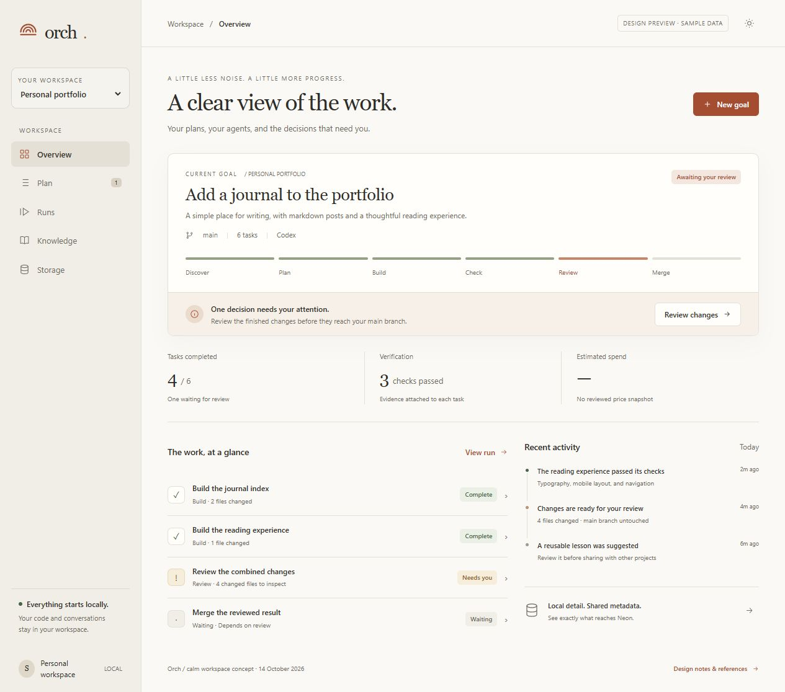

# Make Orch useful outside its own repository

Reviewed 14 October 2026. This is the historical improvement proposal and original HTML design concept. The current-state note under Ranked changes records the later P0 backend coverage and remaining roadmap.

## What matters first

Orch has much more implemented than its “skeleton” description suggests: goal drafting, versioned plan and check approvals, isolated worker branches, integration checks, capacity pauses, routing evidence, reviewed knowledge, a local API, and optional Postgres/Neon sync. The problem is that using those pieces still requires understanding the machinery. Moving to another repository makes that burden more visible.

The proposed milestone was **one trustworthy, understandable journey from goal to reviewed change in another repository**. Its backend contract is now covered by a deterministic second-repository fixture; real provider and Neon operations require separate validation.

Deliverables from this review:

- [Interactive HTML concept](ui-concept.html): a warm, Claude-inspired design with Overview, Plan, Runs, Knowledge, and Storage screens. It uses fixed sample data, makes no database requests, and changes no project files through its controls.
- [Implementation audit](implementation-review.md): source references, confirmed behavior versus inference, recommended fixes, and acceptance checks. The audit ran through live orch task `TASK-028`, in an isolated worktree at base `253effa`; it completed on its second attempt after a credit-limit interruption.
- This file: the product priorities, current Neon diagnosis, external comparisons, and a suggested delivery order.

Existing uncommitted changes in CLI/planning code and tests were preserved. The worker audit describes its pinned base; the baseline test results below describe the current workspace. No merge, deployment, production migration, or remote sync was performed for this review.

## Neon: the data exists, but the selected branch differs

The screenshot supplied during this review shows **production → neondb → public**, with zero tables. The saved local configuration identifies **orch-development** in the same Neon project. A read-only transaction through its saved connection succeeded and found:

| Table in `public` | Rows observed |
| --- | ---: |
| `schema_migrations` | 2 |
| `shared_projects` | 2 |
| `shared_runs` | 26 |
| `shared_run_tasks` | 632 |
| `shared_attempts` | 30 |
| `shared_global_lessons` | 1 |

These are a point-in-time observation of the saved connection, not a count of every Neon branch. The new audit run was not synced as part of this session. Select **orch-development** in the console before comparing its tables with production. The production branch itself was not queried by this review.

There is a second configuration mismatch: `.orch/neon/.env.local` contains `DATABASE_URL`, `DATABASE_URL_UNPOOLED`, and `NEON_BRANCH`. [`neonConfig`](../src/neon-metadata.ts) reads `ORCH_NEON_DEVELOPMENT_URL` or `ORCH_NEON_PRODUCTION_URL` from the process environment. The CLI does not automatically load that saved file. None of those saved settings were inherited by this review's shell. A working saved connection therefore does not mean a fresh `orch shared neon ...` command is configured correctly. The connection includes a password; keep it in local server-side configuration rather than in reports, screenshots, browser storage, or worker instructions.

The database is deliberately a **shared metadata store**, not the full task workspace. [`localSharedSnapshot`](../src/shared-metadata.ts), [the metadata migration](../migrations/001_shared_metadata.sql), and [the lesson migration](../migrations/002_neon_lessons.sql) define the boundary:

| Information | Where it lives today |
| --- | --- |
| Goals, task descriptions, prompts, paths, source changes, check commands, raw output | Local project state and worktrees |
| Run mode/status, task category/risk/dependencies, route, validation verdict, measured tokens/timing | Allowlisted shared tables after explicit sync |
| Pending learning candidates and private project lessons | Local knowledge |
| Reviewed, promoted, generalized global lessons | Eligible for Neon sync |

[`orch shared neon sync`](../src/cli.ts) migrates and writes only when invoked. Running tasks, approving a lesson, or serving the dashboard does not automatically sync. `/api/shared/runs` is a **local projection of what could be shared**, not a remote Neon read. The current UI does not show branch, connection status, last sync, pending records, or sync failure. That is why it can feel as though nothing is reaching the database even when development has rows.

### Smallest storage improvement

1. Add a read-only connection diagnostic for the explicitly selected environment. Show safe branch/database/schema identity, expected table presence, row counts, and actionable configuration errors. Never return a connection string to the browser.
2. Support an explicit local environment-file path, or document the mapping from the saved Neon file to the two Orch settings. Do not silently map a generic `DATABASE_URL` to production.
3. Persist a local sync receipt per environment: successful time, source event position or snapshot digest, counts, duration, and redacted failure. Distinguish “last successful sync,” “new local events since sync,” and “last connectivity check.” A receipt alone does not prove current remote availability.
4. Add Storage to the UI. Show local/private versus shared data, the selected destination, and an explicit sync action. Preserve ordinary local work when Neon is offline. Offer optional automatic sync only later, after the manual path is reliable.
5. Define withdrawal and retention. Current sync upserts lessons and runs but has no remote deletion lifecycle. Removing a promoted lesson locally does not remove its stored remote text. Use explicit tombstones or deliberate reconciliation, scoped to owned records; an empty snapshot must never imply “delete everything.”

Acceptance: a fresh shell reports the configuration mismatch without leaking credentials; development and production are independently labeled; a successful sync has a receipt; a failed sync leaves local execution usable; withdrawn records stay withdrawn and another project's records remain intact.

## What existing orchestrators do well

Primary repositories and their own documentation were reviewed online on 14 October 2026. This is a focused comparison of documented patterns, not a benchmark or a claim that these frameworks can be substituted directly into Orch.

| Project | Verified pattern | What Orch should borrow | Fit / tradeoff |
| --- | --- | --- | --- |
| [OpenHands Agent Canvas](https://github.com/OpenHands/OpenHands) | A self-hosted control center for coding agents with local/remote backends, project workspaces, and automation. | Make project identity and agent activity central; give the user one place to find the conversation, output, and resulting change. | Closest product reference for supervising coding work. Its broader runtime and integrations are more than Orch needs for this milestone. |
| [LangGraph](https://github.com/langchain-ai/langgraph), [persistence docs](https://docs.langchain.com/oss/python/langgraph/persistence) | Persistent checkpoints and human intervention support stateful, resumable execution. | Make recovery a designed state transition with durable evidence, rather than instructions to piece together files after interruption. | Strong reliability reference. It is a lower-level framework, not an out-of-the-box coding workspace. |
| [CrewAI](https://github.com/crewAIInc/crewAI) | Separates collaborating agent teams (“Crews”) from event-driven control flow (“Flows”). | Separate a worker's role from the rules that decide readiness, validation, and completion. Make inputs, expected outputs, and stop conditions explicit in each task. | Useful vocabulary and task contracts. Do not introduce configurable agent personas until they solve a demonstrated need. |
| [Langflow](https://github.com/langflow-ai/langflow) | A visual builder, interactive playground with step control, and workflow deployment through APIs/MCP. | Make individual steps inspectable. Offer a dependency view as an alternative to the task list. | Useful interaction reference, but a general node editor would add complexity to a coding supervisor. |
| [AutoGen Studio](https://github.com/microsoft/autogen/tree/main/python/packages/autogen-studio), [official guide](https://microsoft.github.io/autogen/stable/user-guide/autogenstudio-user-guide/index.html) | Separate team-building and playground interfaces; streamed messages and control-flow visualization. Its guide explicitly describes it as a prototype. | Separate planning from execution, and let a user trace a run without losing the task/result context. | Study the interface; do not treat its prototype UI as proof of production readiness. |

The common useful idea is visibility into a task's **state, evidence, and next action**. Orch already has many of the underlying records. Exposing those clearly is a smaller and more valuable change than adopting an entire new orchestration stack.

## Ranked changes

**Current-state note (IMP-TASK-005):** The P0 rows below record the original milestone and acceptance targets. Backend contracts now cover preflight and pinned context, criterion and named-review gates, isolated workers and checked integration, interruption reconciliation, and per-environment offline storage receipts. The second-repository journey uses deterministic provider and transport fixtures; it does not demonstrate real Neon writes or a target-branch merge. Retention and withdrawal remain the next explicit data-lifecycle work. Transactional local persistence is conditional on crash-boundary evidence that the current reconciliation cannot meet the required invariant. A full project registry/switcher and additional providers remain deferred.

“P0” here means the next product milestone, not a claim that every item is a security incident. Detailed source findings and checks are in [the audit](implementation-review.md).

| Order | Problem to solve | Smallest complete change | How to know it works |
| --- | --- | --- | --- |
| P0 · 1 | Starting in another repository is confusing. | A preflight that names the active project, Git status/base, context availability, enabled provider, verification command, and live versus simulated mode. Default to safe inspection; make one next action prominent. | Use a second repository with an untracked context document and missing provider setup. Explain each blocker before starting a worker. |
| P0 · 2 | “Approved” and “completed” can overstate verification. | Block check approval on uncovered criteria; require recorded named review for human-only criteria before completion. Keep worker completion, checked integration, and merged result distinct. | A task with a missing criterion or unrun human review cannot appear fully verified just because the general build passes. |
| P0 · 3 | Neon state is invisible and its configuration is inconsistent. | Deliver the explicit environment diagnostic, local receipt, and Storage screen above. | A user can locate the correct branch and explain what is synced without reading code. |
| P0 · 4 | Interrupted work is hard to recover safely. | Show “possibly interrupted” when runtime evidence is absent; inspect partial changes; record a preserve/discard decision before retry. Preserve previous attempt evidence. | Kill a fixture worker after an edit. Reopening the UI gives a truthful state and a clear recovery action. |
| P1 · 5 | Task state, attempts, and run events can disagree after a crash. | Define one transition/reconciliation boundary first. Move authoritative local runtime records to transactional storage if crash tests show file-based recovery cannot meet it. Preserve import and export paths. | Crash at each persistence boundary. Recover one consistent state without repeating an external side effect or losing completed work. |
| P1 · 6 | The UI exposes too many mechanisms at once. | Apply the HTML concept to the existing React components: next action first, task list by default, evidence drawer on request, advanced routing/worktree controls in contextual sections. | New users can find the active project, current blocker, last change, verification, and storage destination without searching several screens. |
| P1 · 7 | Shared data has no withdrawal lifecycle. | Explicit, auditable removal intent for synced lessons and retired project metadata. Define retention and ownership before adding automatic deletion. | Withdrawal removes only named owned records and normal resync cannot revive them. |
| P1 · 8 | Moving between projects lacks orientation. | First expose the active repository and the exact way to serve another one. Add a small registry/switcher only after the per-project service ownership model is settled. | Switching between two projects never shows stale detail or performs an action in the other project. |
| P2 · 9 | Providers and routing sophistication are ahead of basic usability. | Keep disabled providers visibly unavailable. Improve routing explanations using measured evidence and preserve “unknown” costs/quota. Add a provider adapter only when requested and tested. | Every shown provider can actually execute; missing prices are not displayed as zero cost. |

Do not relax the existing approval, privacy, or worktree boundaries to simplify the UI. The UI should make those boundaries understandable and guide the user through them.

The current workspace includes a contract that deliberately permits approving a draft with missing check suggestions. Stricter criterion coverage is therefore a proposed product-policy change, not a claim that the code violates that existing contract. Implementing it must update the approval/completion rules, CLI and UI messages, fixtures, and the corresponding contract together.

## UI direction and references

The original [HTML concept](ui-concept.html) uses warm ivory, soft stone, muted terracotta, and restrained sage status accents. Serif page headings give it a quieter, Claude-inspired character; body text uses the system sans-serif stack. It includes no external font requests, image downloads, paid assets, or copied reference source code.

Visual references inspected in a browser:

| Reference | Observation adopted | Deliberate adaptation |
| --- | --- | --- |
| [shadcn/ui dashboard](https://ui.shadcn.com/examples/dashboard) | Compact sidebar, consistent surface spacing, predictable page structure. | Replace analytics-heavy metric cards with current goal, next decision, and task evidence. |
| [Figma dashboard template gallery](https://www.figma.com/templates/dashboard-designs/) — including its Dashboards UI Kit and Purity previews | Light surfaces, generous spacing, and a stable navigation/content boundary. | Use a warmer palette and fewer simultaneous panels. The gallery was inspected; no Figma file was purchased or duplicated. |
| [CodePen: Responsive Admin Dashboard, by eylem](https://codepen.io/eylemsayin/pen/oNQPyvL) | Sidebar and content separation, card grouping, responsive dashboard composition. | Reduce chart prominence, large colored indicators, and card decoration. The rendered preview and source presentation were inspected; no code was copied. |
| [Langflow](https://www.langflow.org/) and its [repository](https://github.com/langflow-ai/langflow) | Explicit input/model controls and step-oriented workflow interaction. | Put a readable task list first; dependencies are a secondary view. |

### What each screen should answer

- **Overview:** Which project is this? What goal is active? What needs me next? What just changed?
- **Plan:** What will happen, in what order, and how will each result be checked? Review a plan without starting workers.
- **Runs:** Which tasks are complete, waiting, failed, or possibly interrupted? Open output, checks, model choice, and branch evidence together. Historical replay must carry an explicit historical label; it must not replace a current-state metric silently.
- **Knowledge:** Which lessons are suggested, reviewed, promoted, or actually supplied to a past worker? Keep retrieval matches separate from recorded use.
- **Storage:** Which environment, database, and schema? What is private/local? What was shared, when, and with what outcome?

The prototype has local navigation, task drawers, evidence tabs, a list/dependency toggle, example approval states, a workspace selector, dark mode, design notes, and a copyable CLI command. Its connection check is explicitly a preview: it makes no database request. The goal composer shows a fixed example plan and does not generate a real plan from entered text. Responsive layouts, keyboard focus, escape-to-close, focus return, and reduced-motion support are included.

Implementation should reuse `ui/src/main.tsx`, `planning-view.tsx`, `workflow-view.tsx`, `knowledge-view.tsx`, `api.ts`, and the existing evidence/replay helpers. Move visual tokens into the existing stylesheet. Add the storage endpoint and receipt in the local service, not in browser-side SQL code. Keep model configuration and worktree controls reachable as advanced contextual detail rather than removing their functionality.

## Suggested delivery sequence

1. **Prove the journey in a second repository.** One small real coding change, complete acceptance checks, preflight, transparent mode, reviewed integration, and no accidental merge. Save the exact blocker/recovery evidence.
2. **Make storage explain itself.** Environment diagnostic, configuration compatibility, sync receipt, and the Storage screen. Reproduce the development/production confusion from this session as an acceptance scenario.
3. **Fix completion and interruption semantics.** Cover missing checks, human review, stale “running” state, and partial-worktree reconciliation. Decide whether transactional local persistence is required from observed failure cases.
4. **Apply the approved design.** Reuse the current React/API boundaries, keep the prototype's hierarchy, and add accurate empty/offline/error states using real records. Preserve historical/current separation.
5. **Address retention and then broaden.** Remote withdrawal, project switching, and provider additions follow a stable core workflow.

Do not schedule the entire roadmap as a single large implementation task. Use bounded orch tasks with explicit acceptance criteria, dependencies, and task-specific checks; keep implementation, integration, and merge review separate.

## Verification performed and limits

- Existing backend suite: **73 passed, 0 failed, 2 skipped** out of 75 tests. The skipped cases are opt-in Docker Postgres and live Neon round trips. Their write paths were not enabled for this review.
- Existing UI unit/contract suite: **13 passed, 0 failed**. Many contracts check exposed structure and positive flows; green results do not invalidate the audit's semantic gaps.
- Codex connection diagnostic passed. Orch audit task `TASK-028` completed after the stopped first attempt was inspected and retried. Its `git diff --check` is only a Git whitespace check and does not establish audit correctness; the parent reviewed the report and current code.
- Saved Neon connection: verified TLS connection and expected-table row counts inside a read-only transaction. No remote rows or schema were changed.
- HTML preview: served locally and inspected in the browser. All five navigation screens, evidence drawer/tabs, Escape, focus return, example plan approval, example connection check, dependency view, and dark theme verified. All five screens fit a 390-pixel mobile viewport without page overflow; navigation fits without horizontal scrolling after the mobile fix. Browser console checks found no errors or warnings. The embedded script also has summary/visibility assertions, and its syntax was checked independently.

External references were reviewed, not installed or benchmarked. No paid design access was used. Proposed fixes remain proposals; the new design is a standalone sample-data artifact awaiting review before React/API integration.
