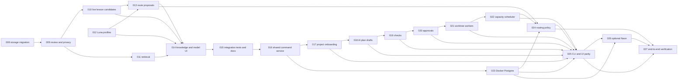

# Orch execution plan and acceptance gates

This document accompanies the saved Orch graph in `.orch/tasks.json`. It does not start a task. Run `node dist/cli.js status` for current states; completed tasks and ready dependencies change as the plan advances.

## Dependency graph



## Acceptance criteria

Each task must satisfy its criteria below and the task-specific check. A passing automated check is one part of review: inspect the diff and recorded evidence before advancing a dependent task.

| Task | Acceptance criteria |
| --- | --- |
| 011 | Retrieval chooses a small, bounded set of approved local and global lessons by task context; each choice has a reason; live prompts contain only those lessons and run events record their IDs. |
| 012 | Luna low, medium, and high can each be selected and shown distinctly; old registry settings and manual weights survive loading. |
| 013 | A cheaper route is only proposed from comparable validated live outcomes and known price snapshots; retries, latency, token use, sample size, uncertainty, manual override, and fallback are visible. |
| 014 | API and UI show reviewed lessons, pending candidates, selected lesson IDs and reasons, profile evidence, and route proposals; simulated observations are labeled and excluded from live performance. |
| 015 | Cross-project reuse, privacy, migration, retrieval, model choice, overrides, and fallback have integration tests; backend and UI regressions pass; docs match behavior. |
| 016 | CLI and UI commands share a versioned service and audit events; legacy CLI/API behavior still works; repository-specific details stay behind the local service. |
| 017 | CLI and UI can register a repository with an opaque ID, Git/check discovery, and a versioned document manifest; remote metadata has no paths or product detail. |
| 018 | A goal produces consequential questions and an editable, versioned dependency plan with task acceptance criteria; drafting does not start workers. |
| 019 | Baseline checks and generated task checks have executable evidence or a named human review; CLI and UI can add a check with phase, timeout, expected result, and revision history; skipped and missing checks are distinct. |
| 020 | Approvals bind to exact plan/check revisions; edits revoke prior approval; run, merge, and deployment stop at their own user gates and resume after the matching approval. |
| 021 | Workers use separate Git worktrees at pinned bases; validation occurs in isolation; combined changes are checked in a temporary integration worktree; conflict and diff review precede merge approval. |
| 022 | Concurrency respects dependencies, provider capacity, configured limits, cost, and overlap; low capacity pauses new starts durably; resume checks interrupted work; unknown quota is shown as unknown. |
| 023 | Docker Postgres stores only allowlisted metadata through migrations; prompts, paths, source, architecture, product details, diffs, and raw output remain local; a privacy test rejects unknown fields. |
| 024 | Routing policy revisions show observed evidence, cost, retries, latency, user constraints, fallback, author, reason, and rollback; constraints override automatic preference. |
| 025 | CLI and UI cover onboarding, clarification, plan and check review, worktree runs, pauses, approvals, learning, and routing history from the same state; local detail is available only through the local project service. |
| 026 | Optional Neon sync uses the Postgres allowlist, authenticated separate environments, and only reviewed generalized global lessons; offline sync leaves local operation usable. |
| 027 | An example project exercises the complete prompt-to-plan-to-checks-to-run-to-integration path, including conflicts, approvals, capacity pause/resume, routing rollback, and privacy across local Postgres and Neon. |

## Test cases to add with the later tasks

The focused workflow suite must use names containing the task tag shown below. These are behavioral cases for the worker to make executable; a tagged placeholder or skipped test does not satisfy the check.

| Task tag | Required behavioral cases |
| --- | --- |
| `[TASK-015]` | Move an approved generalized lesson between two project fixtures without exposing local detail; migrate legacy evidence; exercise retrieval, override, fallback, and simulated filtering through CLI/API together. Add a matching UI test for run-used versus observational evidence. |
| `[TASK-016]` | Apply the same versioned command through CLI and service and compare state and audit ID; reject a stale revision; confirm a shared event omits private project detail. |
| `[TASK-017]` | Register a temporary Git repository twice without duplicating it; change the document manifest and observe a new version; export shared metadata and find no absolute path or document body. |
| `[TASK-018]` | Give an underspecified goal, answer a consequential question, and inspect an acyclic draft with acceptance criteria; edit the draft and confirm a new revision with no worker started. |
| `[TASK-019]` | Record a failing baseline without treating it as a task regression; add a CLI check with phase, timeout, and expected result; execute it and distinguish pass, fail, skipped, and missing. |
| `[TASK-020]` | Approve a plan and checks, revise one, then verify execution refuses stale approval; grant merge approval for one integrated revision and ensure it cannot authorize another or a deployment. |
| `[TASK-021]` | Run sibling tasks in separate worktrees and verify neither sees the other's unmerged edits; detect an integration conflict; leave the target branch unchanged until approved merge. |
| `[TASK-022]` | Inject a near-limit provider signal and verify no new worker starts; checkpoint and resume after capacity returns; mark unknown capacity unknown and recover an interrupted worker safely. |
| `[TASK-023]` | Migrate a fresh Docker Postgres schema; round-trip allowed run metadata; reject a payload containing path, prompt, source, architecture, or raw output even in an unexpected field. |
| `[TASK-024]` | Compare live validated route evidence and apply cost or provider limits; reject an expensive automatic route outside policy; inspect policy history and roll back to the earlier route. |
| `[TASK-025]` | Make a CLI change and observe the same revision in UI/API; approve through UI and observe it in CLI; disconnect the local service and verify repository detail is unavailable without exposing it through shared metadata. |
| `[TASK-026]` | Exercise the Neon adapter with a fake transport, and a configured test database when available; sync only allowlisted metadata and a reviewed generic lesson; reject an unreviewed or identifying lesson; disconnect sync and continue locally without data loss. |
| `[TASK-027]` | Exercise an example project's question, plan, user check, approval, isolated run, integration conflict, capacity pause/resume, route rollback, merge gate, and privacy export as one end-to-end flow. |

## Prepared CLI check

`scripts/check-task.cjs` compiles the backend, runs the existing backend regression suite, requires at least one passing focused acceptance test for the named task, and runs UI checks for UI tasks. It refuses to validate a different task while an Orch task is running. For TASK-011 through TASK-014 it selects the existing knowledge contract suite. TASK-014 also requires `ui/test/orch-workflow.contract.test.cjs`. TASK-015 must add tagged backend and UI integration tests and pass the entire knowledge contract suite. For TASK-016 through TASK-027, the worker must add behavioral tests in `src/orch-workflow.contract.test.ts` with names tagged `[TASK-016]` and so on. TASK-017 through TASK-020, TASK-025, and TASK-027 also require matching UI tests. Missing checks fail instead of allowing an unrelated `npm test` pass.

Inspect the prepared mapping with `node scripts/check-task.cjs --list`. To validate TASK-011 after its code is written, use `node scripts/check-task.cjs TASK-011`. To give the same command to Orch when you choose to start it:

```powershell
node dist/cli.js status
node dist/cli.js doctor codex --timeout-seconds 60
node dist/cli.js run --once --executor codex --check "node scripts/check-task.cjs TASK-011" --timeout-seconds 900
```

After that run, inspect its diff and test result, then use the ID of the next ready task in the check command. `--once` starts one ready task; it does not choose an arbitrary ID. TASK-019 persists task checks and TASK-020 gates drafted runs and records exact merge and deployment approvals. Worktree integration and the actual merge executor belong to TASK-021. No merge or deployment is part of the commands above.

The full product behavior and privacy boundary are specified in [orch-product-contract.md](orch-product-contract.md).
